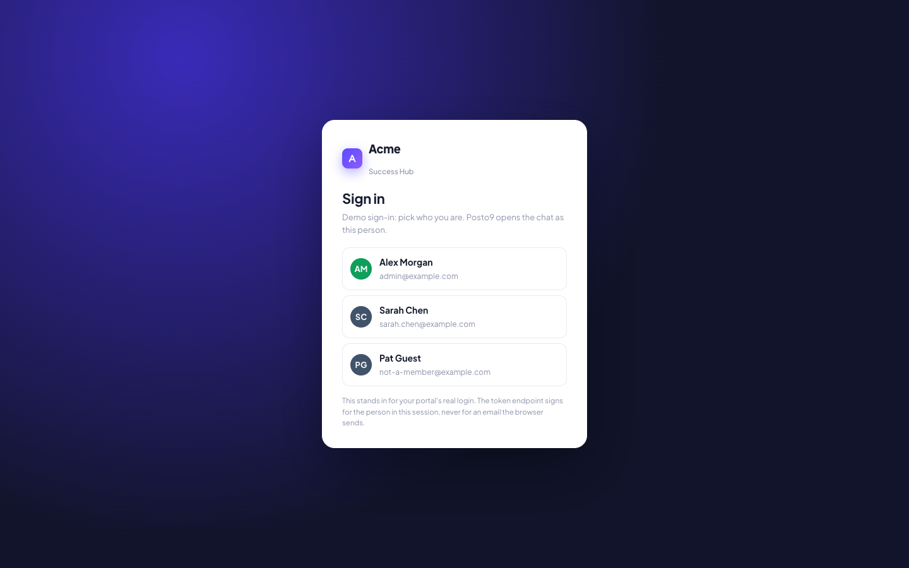
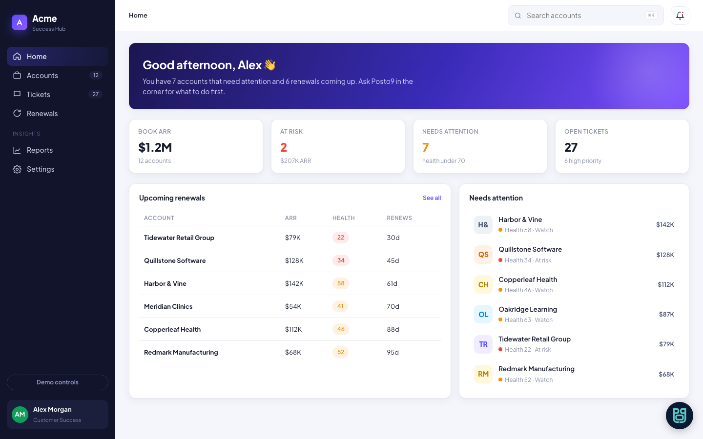
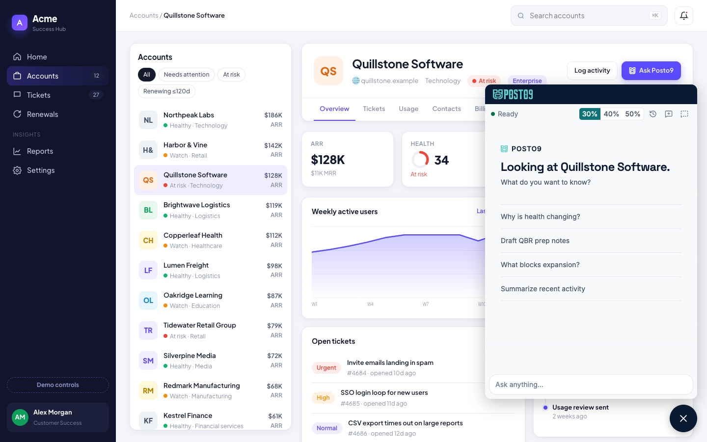

# Posto9 chat widget demo: Acme Success Hub

A small, dependency-free demo of the **Posto9 chat widget** inside a team's own
customer success portal. "Acme Success Hub" is a fictional company's internal CS
tool. Your CSMs open Posto9 from the corner of the portal, and the chat follows
the account on screen.


Use it to:

- **see** the widget in a realistic portal before wiring it into yours;
- **demo** Posto9 to your team with your own workspace's data;
- **copy** the moving parts: the snippet, the token endpoint and the
  sign-in and sign-out handling are the same ones your portal needs.

The full, step-by-step setup guide for any portal is in
**[docs/SETUP_GUIDE.md](docs/SETUP_GUIDE.md)**.

---

## What you need

- **Node.js 18 or newer.** Nothing to install: the demo has no dependencies.
- **A Posto9 workspace** where you are an **Owner or Admin**, with the **Chat
  widget** feature turned on (ask your Posto9 contact if Setup does not show it).
- **An https address for the demo.** Posto9 only lets https pages open the chat.
  Run the demo behind any https tunnel (for example `cloudflared tunnel --url
  http://localhost:3000` or `ngrok http 3000`), or deploy it to any host that
  runs Node.

## Quick start

1. **Get the demo.**

   ```bash
   git clone https://github.com/posto9-app/posto9-widget-demo.git
   cd posto9-widget-demo
   cp .env.example .env
   ```

2. **Give it an https address.** Start your tunnel (or deploy) and note the
   address, for example `https://acme-demo.trycloudflare.com`.

3. **Set up the widget in Posto9.** Open **Setup → Tenant → Chat widget**:
   - click **Generate secret** and copy the secret and the **Widget id**;
   - under **Allowed origins**, add the address from step 2 and click
     **Save origins**.

   

4. **Fill in `.env`.**

   ```bash
   POSTO9_URL=https://your-posto9-address        # from the Setup snippet
   POSTO9_WIDGET_ID=...                          # from step 3
   POSTO9_WIDGET_SECRET=...                      # from step 3
   DEMO_USERS=Sarah Chen <sarah@yourcompany.com>, Michael Ross <michael@yourcompany.com>
   PORT=3000
   ```

   Each `DEMO_USERS` email must belong to a member of your Posto9 workspace who
   can chat. Add one that does not, to show how the widget refuses a stranger.

5. **Point the sample accounts at yours.** Edit `data/accounts.json` and set
   each account's `customer` to its id in Posto9: its Posto9 id, or
   `<provider>:<id>` for an account Posto9 has linked to that CRM record, such
   as `hubspot:1234567890`. Change the names and numbers to match, so the
   portal and Posto9 tell the same story.

6. **Run it** and open your https address.

   ```bash
   npm start
   ```

## Demo script

1. **Sign in** as one of your demo users.

   

2. **Home.** The book at a glance. Open the Posto9 button in the bottom right
   and ask "which accounts need my attention this week?". With no account on
   screen, Posto9 sees the CSM's whole book.

   

3. **Open an account.** The chat locks to it: "Looking at Quillstone
   Software". Ask "why is health changing?" or "draft QBR prep notes". Every
   answer is signed Posto9.

   

4. **Ask about another account in the same chat.** Posto9 refuses: this
   conversation is locked to the account open in the portal.
5. **Resize** the chat to 30%, 40% or 50% of the window from its header.

   

6. **Demo controls** (sidebar, bottom) open a record that is not linked in
   Posto9 (the chat says so and opens without a lock) and show an event log of
   every token and widget call.
7. **Sign in as the non-member** from the user menu: the chat explains it is
   unavailable to them.

   

8. **Sign out** from the user menu: the widget shuts down with the session.

## How it works

```text
Portal page ── loads ──▶ https://<your-posto9>/widget/v1/posto9-widget.js
    │                        draws the Posto9 button and the chat frame
    │
    │ tokenProvider(customer)
    ▼
server.js /api/posto9-token ── signs a 5-minute, single-use token
    (HS256 with your widget secret)  for the CSM in the SESSION
    │
    ▼
Posto9 checks signature, allowed origin, membership ──▶ the CSM chats as themselves
```

| File                   | What it shows                                                                                                                       |
| ---------------------- | ----------------------------------------------------------------------------------------------------------------------------------- |
| `public/index.html`    | The portal: the widget snippet, `Posto9('update')` when the account on screen changes, `Posto9('shutdown')` on sign-out.            |
| `server.js`            | The portal backend: a demo session and the token endpoint. The token is signed for the person in the session, never an email the browser sends. |
| `data/accounts.json`   | The portal's own sample accounts, with the `customer` id that ties each one to Posto9.                                              |
| `docs/SETUP_GUIDE.md`  | How to set the widget up in **your** portal: secret, origins, token endpoint, snippet, Content Security Policy, troubleshooting.     |

The sign-in here is a stand-in for your portal's real login. Everything else,
the token endpoint above all, is the pattern to copy.

## Security notes

- **The secret stays on the server.** `server.js` reads it from `.env`, which
  is git-ignored. Never commit it and never send it to the browser.
- **Sign for the session, not the request.** The token endpoint takes the CSM
  from the signed session cookie. An endpoint that signs whatever email the
  browser sends lets anyone chat as anyone.
- **Rotate if in doubt.** Whoever holds the secret can open a chat as any member
  of your workspace who can chat. **Rotate secret** in Posto9 keeps the old one
  working for 24 hours while you deploy the new one.
- **Allowed origins** in Posto9 decide which pages can show the chat. List the
  demo's address while you use it, and remove it afterwards.

## Troubleshooting

| What you see                                    | What to check                                                                                     |
| ----------------------------------------------- | ------------------------------------------------------------------------------------------------- |
| No Posto9 button                                | `POSTO9_URL` is right; the browser console names the problem.                                     |
| "This page is not allowed to open Posto9 chat"  | Add the demo's exact https address under Allowed origins.                                          |
| "...a sign-in token Posto9 could not verify"    | `POSTO9_WIDGET_ID` and `POSTO9_WIDGET_SECRET` match Setup; your machine's clock is right.          |
| "Your email is not a member ... who can chat"   | The signed-in demo user is not a member of your workspace (or is a viewer).                       |
| "Posto9 could not find the account..."          | The account's `customer` in `data/accounts.json` is not an id Posto9 knows.                        |

More cases, with every message the widget can show, are in
[docs/SETUP_GUIDE.md](docs/SETUP_GUIDE.md#troubleshooting).

## License

[MIT](LICENSE). The sample companies, people and numbers are fictional.
