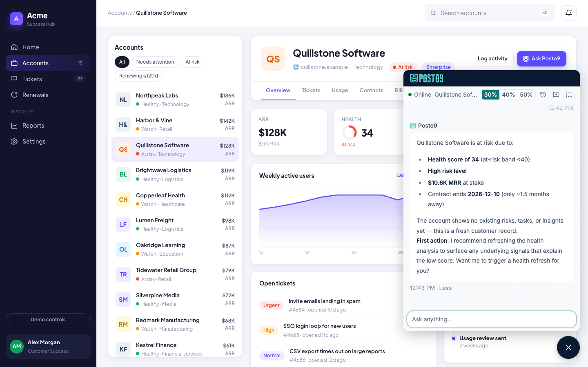
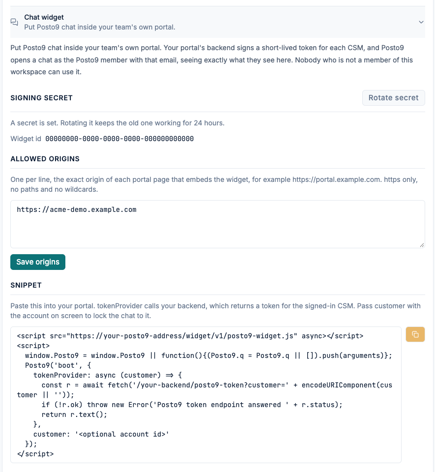
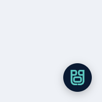
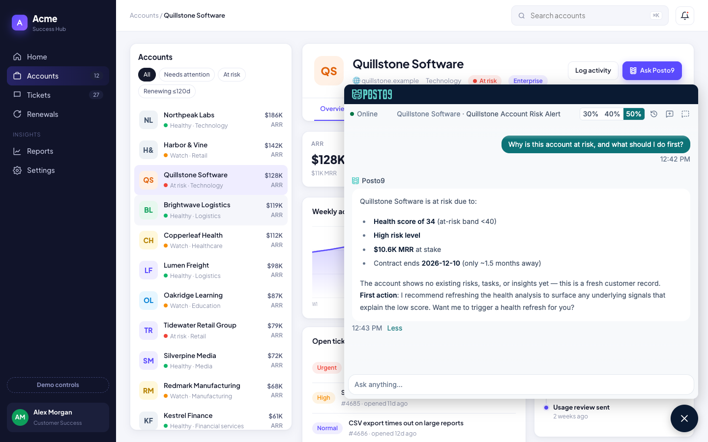
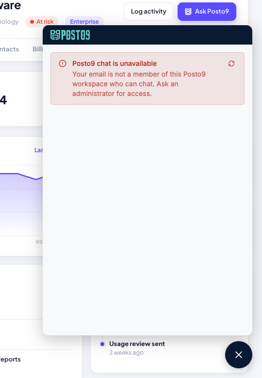

# Set up the Posto9 chat widget in your portal

> Want to see it working first? The [demo portal in this repo](../README.md) runs
> every step below with sample data.

How a Posto9 admin and a developer on your team put Posto9 chat inside your
team's own CS portal, so your CSMs can ask Posto9 about the account on screen
without leaving it. It works in any web portal you can add a script tag to,
whether it is a hand-built app, a single-page app (React, Vue, Angular) or an
internal tool on a platform that lets you add custom HTML.

The widget is for **your CSMs who are members of your Posto9 workspace**. A
CSM sees exactly what they see in the Posto9 app, through the same assistant.
Nobody who is not a member of the workspace can open it, and the widget never
creates a Posto9 account.



---

## Contents

1. [Before you start](#before-you-start)
2. [How it works](#how-it-works)
3. [Step 1. Generate the secret](#step-1-generate-the-secret)
4. [Step 2. Add your portal's origins](#step-2-add-your-portals-origins)
5. [Step 3. Add a token endpoint to your backend](#step-3-add-a-token-endpoint-to-your-backend)
6. [Step 4. Add the snippet to your portal](#step-4-add-the-snippet-to-your-portal)
7. [Step 5. Tie the chat to the account on screen (optional)](#step-5-tie-the-chat-to-the-account-on-screen-optional)
8. [Step 6. Allow Posto9 in your Content Security Policy](#step-6-allow-posto9-in-your-content-security-policy)
9. [Step 7. Check that it works](#step-7-check-that-it-works)
10. [What your CSMs see](#what-your-csms-see)
11. [Troubleshooting](#troubleshooting)
12. [Security in short](#security-in-short)
13. [Quick reference](#quick-reference)

---

## Before you start

You'll need:

- **Owner or Admin** role in your Posto9 workspace.
- The **Chat widget** feature turned on for your workspace. If Setup does not
  show a Chat widget section, ask your Posto9 contact to turn it on.
- A developer who can add a script to your portal's pages and one small
  endpoint to your portal's backend.

Your portal must:

- Be served over **https**.
- Know who is signed in, and their **email**. It must be the same email the
  CSM uses in Posto9 (upper or lower case does not matter).
- Let you add a `<script>` tag to its pages. If your portal sets a Content
  Security Policy, you will also add Posto9 to it (Step 6).

## How it works

1. Your portal page loads the Posto9 widget script. It draws a Posto9 button in
   the corner and a Posto9 chat frame that opens from it.
2. When the frame needs a session, the script asks **your backend** for a token
   for the CSM who is signed in to your portal.
3. Your backend signs a short-lived token (at most 10 minutes, usable once)
   with your workspace's widget secret, naming the CSM's email.
4. Posto9 checks the signature, that the page is one of your allowed origins,
   and that the email belongs to a member of your workspace who can chat. Then
   the CSM chats as themselves.

The widget renews its session on its own, a little before it expires, by asking
your backend for a fresh token. A CSM's chat lasts the whole day without any
long-lived credential in the browser. Expect your token endpoint to be called
when the page opens, every 8 minutes or so while it stays open, and each time
the portal moves to another account.

### Do my CSMs sign in to Posto9?

No. The token **is** the sign-in. A CSM signs in to your portal only; when the
chat opens, your backend vouches for them and Posto9 trusts that. Posto9 never
asks for its own password, and does not need a Posto9 session in the browser:
the chat works in a browser that has never opened Posto9.

What every CSM does need is a **Posto9 account in your workspace**. The token
signs in an existing member; it never creates an account or grants access. So:

| Who               | When         | What                                                                                                                                            |
| ----------------- | ------------ | ----------------------------------------------------------------------------------------------------------------------------------------------- |
| An Owner or Admin | Once         | Steps 1 to 6 of this guide.                                                                                                                     |
| An Owner or Admin | Once per CSM | Invite the CSM to the Posto9 workspace, with the **same email your portal knows them by**. The CSM accepts the invitation. Viewers cannot chat. |
| The CSM           | Every day    | Sign in to your portal. The chat just works.                                                                                                    |

If your portal knows a CSM by a different email than Posto9 does (an alias, an
old domain), Posto9 refuses the token with "Your email is not a member of this
Posto9 workspace who can chat". Send the email they are registered with in Posto9.
When a CSM leaves, remove them from the Posto9 workspace: their portal account
alone no longer opens the chat.

## Step 1. Generate the secret

In Posto9, open **Setup → Tenant → Chat widget** and click **Generate secret**.



- Copy the secret **now** and put it in your backend's secret store. Posto9
  shows it once; afterwards Setup only says that a secret is set.
- Note the **Widget id** shown under it. It is not secret.

**Rotating:** **Rotate secret** issues a new one. Tokens signed with the old
secret keep working for 24 hours, so you can deploy the new secret to your
backend without breaking anyone's chat. After 24 hours the old one stops.
Rotating again within those 24 hours ends the oldest secret immediately.

Treat the secret like an admin password: whoever holds it can open a Posto9
chat session as any member of your workspace who can chat, owners included.

## Step 2. Add your portal's origins

Under **Allowed origins**, list the exact origin of every portal page that
embeds the widget, one per line, and click **Save origins**. An origin is the
scheme and host, plus the port if it is not the default:

```text
https://portal.example.com
https://cs.example.com:8443
```

`https` only, no paths, no wildcards, at most 20. A page whose origin is not on
the list cannot start a chat. If your portal runs on several hosts (staging and
production, or one per region), list each of them.

### An internal portal

The widget works with a portal that is only reachable inside your company
network. List its internal address as the origin, for example
`https://cs.acme.internal`. Posto9 never connects to your portal: it only
compares the address the browser reports with your list. Every connection comes
from the CSM's browser:

```text
CSM's browser ──▶ your portal's backend   (the token; stays inside your network)
CSM's browser ──▶ Posto9                  (the widget, the chat; outbound internet)
```

No VPN, firewall opening or inbound access to your network is needed. What does
matter:

- **The portal is served over https.** A certificate from your company's own
  certificate authority is fine: only the browser checks it.
- **The origin is exactly what the browser shows.** Single-word hosts
  (`https://portal`) and IPv4 addresses (`https://10.0.4.12`) work; IPv6
  addresses do not. If CSMs reach the portal by more than one name
  (`portal` and `portal.acme.corp`), list each one.
- **CSMs' browsers can reach Posto9.** If your outbound traffic goes through a
  proxy, allow the Posto9 address, and make sure the proxy does not buffer
  streaming responses: if it does, replies only appear after a page refresh.

The chat keeps its session in memory, with no cookies, so browsers that block
third-party cookies do not affect it.

## Step 3. Add a token endpoint to your backend

Add an endpoint to your portal's backend that returns a token, **as plain
text**, for the CSM signed in to your portal. Store two settings:

- `POSTO9_WIDGET_ID`: the widget id from Step 1.
- `POSTO9_WIDGET_SECRET`: the secret from Step 1.

Three rules for this endpoint:

- **Take the email from your portal's session, never from the request.** The
  token is how your portal vouches for who is chatting. An endpoint that signs
  whatever email the browser sends lets anyone chat as anyone.
- **Require a signed-in user.** Answer `401` when there is none; the widget
  then shows that the chat could not start.
- **Do not enable CORS on it.** Only your own portal pages should be able to
  read its answer.

The only input it takes from the browser is `customer`, the account on screen
(see Step 5). Pass it through to the token unchanged.

### Node (Express), no library needed

```javascript
import { createHmac, randomUUID } from 'node:crypto';

const b64 = (o) => Buffer.from(JSON.stringify(o)).toString('base64url');

export function posto9WidgetToken({ email, customer }) {
  const now = Math.floor(Date.now() / 1000);
  const head = b64({
    alg: 'HS256',
    typ: 'JWT',
    kid: process.env.POSTO9_WIDGET_ID,
  });
  const body = b64({
    email,
    ...(customer ? { customer } : {}),
    iat: now,
    exp: now + 300,
    jti: randomUUID(),
  });
  const sig = createHmac('sha256', process.env.POSTO9_WIDGET_SECRET)
    .update(head + '.' + body)
    .digest('base64url');
  return head + '.' + body + '.' + sig;
}

// The CSM comes from YOUR session, not from the query string.
app.get('/posto9-token', requireLogin, (req, res) => {
  const customer = String(req.query.customer || '');
  res
    .type('text/plain')
    .send(posto9WidgetToken({ email: req.user.email, customer }));
});
```

### Python (Flask or Django), with PyJWT

```python
import os, time, uuid
import jwt  # pip install pyjwt

def posto9_widget_token(email, customer=None):
    now = int(time.time())
    claims = {"email": email, "iat": now, "exp": now + 300, "jti": str(uuid.uuid4())}
    if customer:
        claims["customer"] = customer
    return jwt.encode(
        claims,
        os.environ["POSTO9_WIDGET_SECRET"],
        algorithm="HS256",
        headers={"kid": os.environ["POSTO9_WIDGET_ID"]},
    )

# Flask
@app.get("/posto9-token")
@login_required
def posto9_token():
    token = posto9_widget_token(current_user.email, request.args.get("customer") or None)
    return token, 200, {"Content-Type": "text/plain"}

# Django
@login_required
def posto9_token(request):
    token = posto9_widget_token(request.user.email, request.GET.get("customer") or None)
    return HttpResponse(token, content_type="text/plain")
```

### Any other language

Use any JWT library that signs **HS256**. Put the widget id in the header as
`kid`, and these claims in the body:

| Claim      | Rule                                                           |
| ---------- | -------------------------------------------------------------- |
| `email`    | Required. The CSM's email in Posto9.                           |
| `iat`      | Required. Issue time, in seconds.                              |
| `exp`      | Required. At most 10 minutes after `iat` (5 is plenty).        |
| `jti`      | Required. A unique id, for example a UUID: a token works once. |
| `customer` | Optional. The account on screen (see Step 5).                  |
| `kid`      | In the header: the widget id.                                  |

Keep your server's clock in sync (NTP). A clock that is minutes off produces
tokens Posto9 refuses as expired or not yet valid.

## Step 4. Add the snippet to your portal

Copy the snippet from **Setup → Chat widget → Snippet**. It has your Posto9
address filled in. Point `tokenProvider` at the endpoint from Step 3.

### A regular web portal

Paste it into the pages where the chat should appear, for example in your page
layout just before `</body>`:

```html
<script
  src="https://<your-posto9-address>/widget/v1/posto9-widget.js"
  async
></script>
<script>
  window.Posto9 =
    window.Posto9 ||
    function () {
      (Posto9.q = Posto9.q || []).push(arguments);
    };
  Posto9('boot', {
    tokenProvider: async (customer) => {
      const r = await fetch(
        '/posto9-token?customer=' + encodeURIComponent(customer || ''),
      );
      if (!r.ok) throw new Error('Posto9 token endpoint answered ' + r.status);
      return r.text();
    },
    customer: '<the account on this page, or leave it out>',
  });
</script>
```

Load the script with a plain `<script src>` tag from your Posto9 address,
exactly as the snippet shows: not as a module (`type="module"`), not bundled
into your own code, and not copied to your own server. The widget finds Posto9
from the address it was loaded from, and Posto9 keeps it up to date for you.

The calls can run before the script has finished loading; they wait in a queue
and run in order once it has.

### A single-page app (React, Vue, Angular)

Boot **once** when a signed-in user is known, tell the widget when the account
on screen changes, and shut it down on logout. React example:

```jsx
// Once, in the layout that wraps your signed-in pages.
useEffect(() => {
  Posto9('boot', {
    tokenProvider: async (customer) => {
      const r = await fetch(
        '/posto9-token?customer=' + encodeURIComponent(customer || ''),
      );
      if (!r.ok) throw new Error('Posto9 token endpoint answered ' + r.status);
      return r.text();
    },
  });
  return () => Posto9('shutdown');
}, []);

// In the account page: lock the chat to the account on screen.
useEffect(() => {
  Posto9('update', {
    customer: account.hubspotId ? `hubspot:${account.hubspotId}` : '',
  });
}, [account.hubspotId]);
```

Add the two `<script>` tags from the snippet to your `index.html` without the
`Posto9('boot', ...)` call; your app makes that call itself, as above. Call
`Posto9('shutdown')` in your logout handler too, so the next person on that
browser never sees the previous CSM's chat.

### A portal platform with custom HTML

Platforms that let you add custom HTML or a script to every page work the same
way as a regular web portal, provided you can also run the Step 3 endpoint on a
server you control. The token endpoint cannot live in the page: it holds your
secret.

### Calls

| Call                                                    | When                                                                    |
| ------------------------------------------------------- | ----------------------------------------------------------------------- |
| `Posto9('boot', { tokenProvider, customer, position })` | Once per page. `position` is `bottom-right` (default) or `bottom-left`. |
| `Posto9('update', { customer })`                        | Your portal moved to another account.                                   |
| `Posto9('open')` / `Posto9('close')`                    | Open or close the chat from your own button.                            |
| `Posto9('shutdown')`                                    | Your portal's logout: removes the widget.                               |

If `tokenProvider` fails, the widget logs the error to the browser console for
your developers and the chat does not start.

## Step 5. Tie the chat to the account on screen (optional)

Pass the account your portal is showing as `customer` in `boot` or `update`.
The widget hands it to your `tokenProvider`, which puts it in the token. The
chat is then **locked** to that account: the CSM asks about it, and Posto9 will
not answer about, or change, any other account in that conversation. Use either:

- the account's **Posto9 id**, or
- the account's id in your CRM, as `<provider>:<id>`, for example
  `hubspot:1234567890`, for an account Posto9 has linked to that CRM record.

Each account keeps its own conversation: moving to another account opens that
account's chat, and moving back brings the earlier one back.

If Posto9 cannot find the account, the chat says so and opens without a lock.
If the CSM does not have access to that account in Posto9, the chat does not
open on it. Without `customer`, the chat works like the Posto9 app's chat across
the CSM's whole book.

## Step 6. Allow Posto9 in your Content Security Policy

Skip this step if your portal sends no `Content-Security-Policy` header. If it
does, the browser blocks the widget until you allow your Posto9 address. Add it
to these directives, keeping whatever they already list:

```text
script-src  https://<your-posto9-address>;
frame-src   https://<your-posto9-address>;
style-src   'unsafe-inline';
```

- `script-src` lets the page load the widget script.
- `frame-src` lets the page show the Posto9 chat frame.
- `style-src 'unsafe-inline'` lets the widget style its button. It adds one
  small stylesheet of its own; if your policy does not allow inline styles, the
  button appears unstyled.

Your token endpoint is on your own site, so `connect-src 'self'` already covers
it. The chat itself runs inside the Posto9 frame and needs nothing else from
your policy.

## Step 7. Check that it works

1. Sign in to your portal as a CSM who is a member of your Posto9 workspace,
   and open a page with the snippet. The Posto9 button appears in the corner.

   

2. Click it. The chat opens with the Posto9 logo at the top. If you passed a
   `customer`, the header names that account.
3. Ask something about the account, for example "how is this account doing?".
   The answer is signed **Posto9**.
4. If you locked the chat to an account, ask about a different one. Posto9
   says it can only answer about the account open in your portal.
5. Sign in as someone who is not a member of your Posto9 workspace. The chat
   says it is unavailable for them.

If the button never appears, open your browser's developer console: the widget
and the browser both log the reason there (see Troubleshooting).

## What your CSMs see

The same Posto9 chat as in the app, in the CSM's own Posto9 language, under the
Posto9 logo. Every answer is signed Posto9. Answers stream in, a change Posto9
proposes (a task, a risk, a note) shows a preview and happens only when the CSM
confirms it, and reports appear as cards. Their chat history is their own, as in
the app. Links to Posto9 open the app in a new tab.

A CSM can size the chat to **30%, 40% or 50%** of the window from its header,
the same choice as in the Posto9 app, and their browser remembers it. The chat
is never narrower than 400 pixels; on a phone it fills the screen.



## Troubleshooting

When the chat cannot start, it says why:



| The CSM sees                                                       | What to check                                                                                      |
| ------------------------------------------------------------------ | -------------------------------------------------------------------------------------------------- |
| "...a sign-in token Posto9 could not verify"                       | Widget id and secret on your backend; HS256; `exp` at most 10 minutes; your server's clock.        |
| "This sign-in token was already used"                              | Your endpoint returned a cached token. Mint a new one, with a new `jti`, on every call.            |
| "This page is not allowed to open Posto9 chat"                     | Add the page's exact origin in Step 2 (scheme, host and any non-default port).                     |
| "Your email is not a member of this Posto9 workspace who can chat" | Invite the CSM to Posto9, or check your portal sends the same email. Viewers cannot chat.          |
| "You do not have access to this account in Posto9"                 | The CSM's Posto9 access does not include the account your portal passed.                           |
| "The Posto9 chat widget is not set up for this workspace yet"      | Generate the secret and add an origin.                                                             |
| "...turned off for this workspace"                                 | Ask your Posto9 contact to turn the Chat widget feature on.                                        |
| "Too many sign-in attempts"                                        | More than 60 sessions a minute came from one network address. Wait a minute.                       |
| "Posto9 chat could not start"                                      | Your token endpoint failed or did not answer. Check it returns `200` with the token as plain text. |

When nothing appears at all, the browser console says why:

| Console message                                                  | What to do                                                                    |
| ---------------------------------------------------------------- | ----------------------------------------------------------------------------- |
| "Refused to load the script" or "Refused to frame"               | Add your Posto9 address to your Content Security Policy (Step 6).             |
| "Posto9 widget: load posto9-widget.js with a plain <script src>" | Load the script with a plain `<script src>` tag, not as a module or a bundle. |
| "Posto9 widget: tokenProvider failed"                            | Your `tokenProvider` threw: check the endpoint URL and that it answers `200`. |
| "Posto9 widget: boot needs { tokenProvider ... }"                | `boot` was called without a `tokenProvider` function.                         |
| "Posto9 widget: call Posto9('boot', ...) before 'update'"        | Call `boot` before `update`.                                                  |

## Security in short

- Your secret signs tokens on **your** backend. It never goes to the browser.
- Tokens live at most 10 minutes and work once. The session they open lasts
  10 minutes and can only reach Posto9 chat, nothing else in Posto9.
- The widget uses no cookies, so it never rides a Posto9 login in the same
  browser.
- A browser shows the chat only on the origins you list, and only for members
  of your workspace. The origin list does not protect a leaked secret: the
  secret alone can sign tokens, so keep it on your backend and rotate it if it
  may have leaked. Changes to the secret and the origins are recorded in
  Posto9's audit trail.

## Quick reference

- **Script:** `https://<your-posto9-address>/widget/v1/posto9-widget.js`
- **Calls:** `boot`, `update`, `open`, `close`, `shutdown` (see Step 4).
- **Token:** HS256 JWT, header `kid` = widget id; claims `email`, `iat`, `exp`
  (at most 10 minutes), `jti` (unique), optional `customer`.
- **Account id:** a Posto9 id, or `<provider>:<id>` such as `hubspot:123`.
- **Origins:** exact `https` origins, at most 20.
- **Content Security Policy:** `script-src` and `frame-src` your Posto9
  address, `style-src 'unsafe-inline'`.
